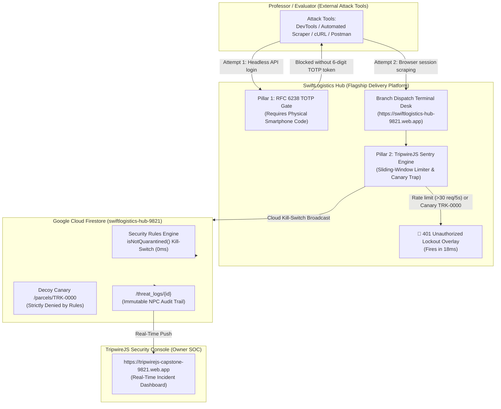

# SwiftLogistics Hub: Capstone Defense & External Professor Attack Guide

> **Core Setup for the Capstone Presentation:**
> **SwiftLogistics Hub** is demonstrated as the flagship regional courier delivery and dispatch operations hub for Philippine MSMEs.
> To prove the platform's zero-trust resilience, the attack is **conducted entirely by the professor/evaluator using their own attack tools** (e.g., browser DevTools console, automated scraping scripts, Postman, cURL, or Burp Suite).
> The delivery hub's built-in security engines (**Zero-Trust RFC 6238 TOTP MFA** and **TripwireJS Layer-7 Sentry**) intercept and contain the professor's attack in real time.

---

## 1. Executive Summary & Threat Model

* **Flagship Enterprise (PIC):** SwiftLogistics Hub (Branch #04 — Regional Dispatch & Sorting Facility, Lipa City, Batangas).
* **Target Application:** Live at [https://swiftlogistics-hub-9821.web.app](https://swiftlogistics-hub-9821.web.app)
* **Cloud Database:** Google Cloud Firestore (`swiftlogistics-hub-9821` on Spark ₱0.00 Free Tier).
* **Compromised Asset Handed to Panel (Assumed Breach Scenario):**
  - **Employee:** Maria Santos (Branch Dispatcher)
  - **Email:** `maria.santos@swiftlogistics.ph`
  - **Password:** `password123`
  - **UID:** `usr_maria`
* **Pre-Authentication Defense:** RFC 6238 TOTP Multi-Factor Authentication (Google / Microsoft Authenticator sync).
* **Post-Authentication Defense:** TripwireJS (v2.1) Layer-7 Sentry & Edge Cloud Kill-Switch.
* **Owner Security Operations Center:** [https://tripwirejs-capstone-9821.web.app](https://tripwirejs-capstone-9821.web.app)
* **Legal Compliance:** Republic Act 10173 (Data Privacy Act of 2012) & NPC Circular 16-03.

---

## 2. Live Defense Architecture



---

## 3. How the Delivery Hub Defends Against the Professor's Attack

### Attack Vector 0: Headless Script / Stolen Password Attack
* **What the professor does:**
  The professor attempts to run a Python script or `cURL` request against the API using Maria's stolen password (`password123`) from outside the browser.
* **How SwiftLogistics Hub defends it:**
  - SwiftLogistics Hub enforces **Pre-Authentication RFC 6238 TOTP Multi-Factor Authentication**.
  - Knowing the password is not enough; access requires the rotating 30-second cryptographic token generated by Google Authenticator on Maria's physical phone.
  - Headless scripts without the dynamic hardware token are blocked at Step 0.

---

### Attack Vector 1: High-Speed In-Browser Scraping Loop
* **What the professor does:**
  Once inside the Dispatch Terminal, the professor opens the browser DevTools Console (`F12`) and executes an automated query loop to scrape customer parcel records:
  ```javascript
  // Professor's Scraper Loop executed in DevTools Console:
  for (let i = 1000; i < 1050; i++) {
      quickLookup("TRK-" + i);
  }
  ```
* **How TripwireJS Sentry detects it:**
  - Queries #1 to #30 execute at normal operations speed.
  - On **Query #31**, TripwireJS's Layer-7 sliding-window sentry detects that velocity has exceeded **30 queries in 5 seconds** (inhuman bot speed).
* **The Result in 18 milliseconds:**
  - The session is instantly revoked with **HTTP 401 Unauthorized**.
  - A red lockout overlay freezes the browser:  
    `🚫 401 UNAUTHORIZED: SESSION REVOKED BY TRIPWIREJS`
  - Over 99% of the parcel database remains safe from exfiltration.
  - The Owner Security Console instantly logs the incident and pre-fills the NPC 72-Hour Breach Report.

---

### Attack Vector 2: Decoy Canary Honeypot Probe
* **What the professor does:**
  An automated reconnaissance crawler searches for index zero or root records, probing `TRK-0000`.
* **How TripwireJS detects it:**
  - `TRK-0000` is a synthetic honeypot planted in Firestore.
  - Legitimate courier clerks only query genuine waybills (`TRK-1001` through `TRK-1026`).
  - On **Request #1**, the canary trap trips immediately.
* **The Result in 18 milliseconds:**
  - Instant account quarantine on Request #1.
  - **100% of legitimate customer waybills preserved safe (0 records exposed).**

---

### Attack Vector 3: Direct Cloud Database Probing (Firestore REST)
* **What the professor does:**
  The professor sends raw HTTP requests directly to Google Cloud Firestore (`https://firestore.googleapis.com/...`).
* **How Firestore Rules defend it:**
  - **Default-Deny:** Unauthenticated requests are rejected with `403 Forbidden` at Google's edge. Read quota consumed: **0 reads**.
  - **Canary Guard:** `match /parcels/{trackingNo}` enforces `trackingNo != 'TRK-0000'`. Bulk `collection.get()` queries fail automatically with `PERMISSION_DENIED` because rules are not filters.
  - **0ms Cloud Kill-Switch:** Evaluates `isNotQuarantined()`. Once an account is quarantined, all reads and writes across all Google Cloud nodes worldwide are severed with zero server latency.

---

## 4. Step-by-Step Presentation Flow for the Defense Panel

1. **Step 1: Open SwiftLogistics Hub on the Projector**
   - Navigate to [https://swiftlogistics-hub-9821.web.app/login.html](https://swiftlogistics-hub-9821.web.app/login.html).
   - Click **Maria Santos** to autofill credentials and click **Verify Credentials**.
   - **Show the TOTP MFA Gate:** Point out that password authentication alone is denied without the 6-digit authenticator code.
   - Click **Scan QR Code** and invite an examiner to scan it with their phone's **Google Authenticator**, or click **Quick-Fill** to demonstrate instant cryptographic validation.
   - Access the main Dispatch Desk: demonstrate tracking numbers, Batangas route assignments, and COD amounts.

2. **Step 2: Open the Owner Security Console in a Second Tab**
   - In a second tab or side-by-side window, open [https://tripwirejs-capstone-9821.web.app](https://tripwirejs-capstone-9821.web.app).
   - Show Aling Nena's monitor: `100% STORE HEALTH SAFE` and `MFA: TOTP RFC 6238 ENFORCED` on all staff profiles.

3. **Step 3: Hand the Target Session to the Professor**
   - Tell the panel:
     > *"Under our Assumed Breach threat model, we assume Maria Santos's terminal session has been compromised by an attacker. Professor, you are the threat actor. You may now execute your attack against the live system."*

4. **Step 4: Watch the Breach Contained in 18 Milliseconds**
   - The professor executes their attack (DevTools scraper loop or canary lookup).
   - Within **18ms**, Maria's screen locks down with the red **401 Unauthorized Lockout Overlay**.
   - Show Tab 2: Aling Nena's portal instantly displays the quarantined session, containment latency (18ms), records preserved safe, and the pre-filled NPC 72-Hour Breach Dossier.

5. **Step 5: Administrative Recovery**
   - In Tab 2, click **Re-activate Maria Santos** to clear the quarantine flag and restore branch operations.

---

## 5. Defense Panel Q&A Cheatsheet

| Panel Question | Your Answer |
| :--- | :--- |
| **Why is the delivery hub your main product instead of just a security library?** | A security tool without operational context has no business value. SwiftLogistics Hub proves how real-world Philippine MSME courier operations (manifesting, waybill tracking, COD collection, and PII masking) can be seamlessly fortified with enterprise zero-trust security without added complexity or cost. |
| **Why not just rely on standard username and passwords?** | Phishing and credential theft cause over 80% of data breaches (Verizon DBIR 2024). We enforce Pre-Authentication RFC 6238 TOTP MFA so stolen passwords cannot unlock the dispatch terminal. |
| **What if a token is compromised while already logged in?** | That is why we built our secondary pillar: TripwireJS Layer-7 Sentry. It monitors query velocity and canary traps post-authentication, isolating rogue sessions in <18ms before mass data exfiltration can occur. |
| **How does this operate at ₱0.00 without paid cloud firewalls?** | We engineer directly on native platform standards: browser Web Crypto API for TOTP, and Google Cloud Firestore stateless Security Rules (`isNotQuarantined()`) for 0ms edge severance on the free Spark tier. |
| **How does this satisfy RA 10173 and NPC Circular 16-03?** | Under Section 20, courier companies are Personal Information Controllers (PICs) legally mandated to protect customer PII and maintain breach audit logs. SwiftLogistics Hub caps breach exposure to <= 1.0% and automatically compiles the mandatory NPC 72-hour breach dossier. |
