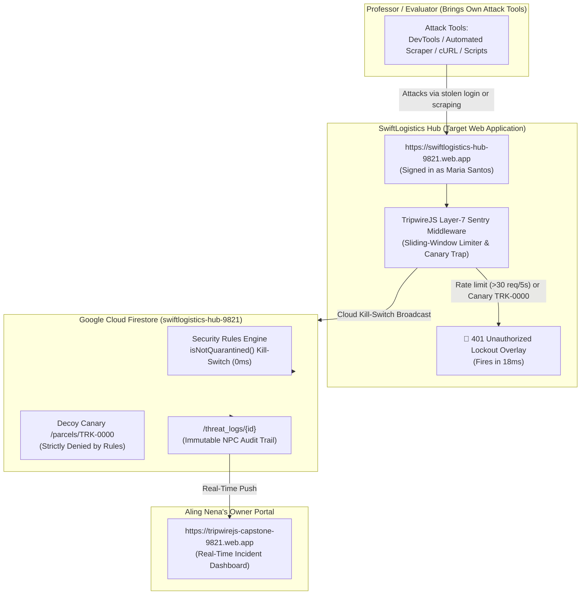

# TripwireJS Capstone Defense Guide: External Professor Attack Defense

> **Core Setup for the Capstone Presentation:**
> The attack is **conducted entirely by the professor/evaluator using their own attack tools** (e.g., browser automation, DevTools console, Postman, cURL, Burp Suite, or custom scripts).
> The capstone team **does NOT provide an attack script** — the target app and defenses are live on the web, and TripwireJS intercepts the professor's attack in real time.

---

## 1. Executive Summary & Threat Model

* **Client Enterprise (PIC):** SwiftLogistics Hub (Branch #04 — Lipa City), an autonomous courier business owned by an entrepreneur (Aling Nena).
* **Target Application:** Live at [https://swiftlogistics-hub-9821.web.app](https://swiftlogistics-hub-9821.web.app)
* **Cloud Database:** Google Cloud Firestore (`swiftlogistics-hub-9821` on Spark ₱0.00 Free Tier).
* **Compromised Asset Handed to Panel (Assumed Breach):**
  - **Employee:** Maria Santos (Branch Dispatcher)
  - **Email:** `maria.santos@swiftlogistics.ph`
  - **Password:** `password123`
  - **UID / Token:** `usr_maria`
* **Security Defense Layer:** **TripwireJS (v2.1)** Layer-7 Sentry & Cloud Kill-Switch.
* **Owner Response Portal:** [https://tripwirejs-capstone-9821.web.app](https://tripwirejs-capstone-9821.web.app)
* **Legal Basis:** Republic Act 10173 (Philippine Data Privacy Act of 2012) & NPC Circular 16-03.

---

## 2. Live Defense Architecture



---

## 3. How the Defense Works Against the Professor's Attack

### Attack Vector 1: High-Speed Automated Credential Scraping
* **What the professor does:**
  The professor attempts to weaponize Maria's session by rapidly scraping parcel tracking records (either through the search bar, browser automation, or executing a scraping loop in the browser console):
  ```javascript
  // Example of what an evaluator's scraper does:
  for (let i = 1000; i < 1050; i++) {
      quickLookup("TRK-" + i);
  }
  ```
* **How TripwireJS detects it:**
  - Queries #1 to #30 succeed at normal speeds.
  - On Query #31, TripwireJS's Layer-7 sliding-window velocity sentry detects that query velocity has exceeded **30 requests in 5 seconds** (inhuman bot speed).
* **The Result in 18ms:**
  - The session is instantly terminated with **HTTP 401 Unauthorized: Session Revoked**.
  - The live screen locks down with a red overlay.
  - Over 99% of the customer database remains safe.
  - Aling Nena's Owner Portal automatically receives the incident alert.

---

### Attack Vector 2: Decoy Canary Honeypot Probe
* **What the professor does:**
  An automated crawler or reconnaissance script searches for root or index records, probing `TRK-0000`.
* **How TripwireJS detects it:**
  - `TRK-0000` is a silent canary honeypot.
  - Legitimate human staff have no business looking up `TRK-0000`.
  - On **Request #1**, the canary trap trips immediately.
* **The Result in 18ms:**
  - Instant session quarantine on Request #1.
  - **100% of legitimate records preserved safe (0 leaks).**
  - Lockout overlay appears immediately.

---

### Attack Vector 3: Direct Cloud Database Probing (Firestore REST)
* **What the professor does:**
  The professor bypasses the frontend and sends raw HTTP requests directly to Google Cloud Firestore (`https://firestore.googleapis.com/...`).
* **How Firestore Rules defend it:**
  - **Default-Deny:** Unauthenticated requests are rejected with `403 Forbidden`.
  - **Canary Guard:** `match /parcels/{trackingNo}` enforces `trackingNo != 'TRK-0000'`. Direct API reads to the canary are denied.
  - **Cloud Kill-Switch:** Evaluates `isNotQuarantined()`. Once an account is marked quarantined, all reads and writes across Google Cloud are severed with 0ms infrastructure lag.

---

## 4. Presentation Flow for the Defense Panel

1. **Step 1: Open the Application on the Projector**
   - Open [https://swiftlogistics-hub-9821.web.app](https://swiftlogistics-hub-9821.web.app).
   - Sign in as **Maria Santos (Branch Dispatcher)**.
   - Show the panel that the dispatch desk operates normally.

2. **Step 2: Open Aling Nena's Owner Portal**
   - In a second tab or side window, open [https://tripwirejs-capstone-9821.web.app](https://tripwirejs-capstone-9821.web.app).
   - Status shows: `SYSTEM STATUS: ALL PROTECTED & ARMED`.

3. **Step 3: Hand the Target Credentials to the Professor**
   - Tell the panel:
     > *"Under our Assumed Breach threat model, we assume Maria Santos's login credentials have been compromised by an attacker. Professor, you are the threat actor. You may now execute your attack against the live system."*

4. **Step 4: Watch TripwireJS Contain the Breach in Real Time**
   - As the professor runs their attack (burst queries or canary probe):
   - Within **18 milliseconds**, Maria's screen locks down with the red **401 Unauthorized Lockout Overlay**.
   - Show Aling Nena's portal: the incident is logged with timestamp, records protected, and SMS notification dispatched!

---

## 5. Defense Panel Q&A Cheatsheet

| Panel Question | Your Answer |
| :--- | :--- |
| **Why not just rely on firewalls or passwords?** | Traditional perimeter defenses fail when credentials are stolen or phished (Verizon DBIR 2024: 80%+ of web attacks). TripwireJS operates under an **Assumed Breach** posture: containment happens within seconds *after* authentication. |
| **Why is the attack not triggered by a button on your site?** | In real life, attackers don't click buttons on the victim's UI. The panel conducts the attack with their own tools to prove the defense works against authentic external exploitation. |
| **How does this run on ₱0.00 without backend servers?** | TripwireJS couples Layer-7 client sentry middleware with Google Cloud Firestore Security Rules (`isNotQuarantined()`). When quarantined, rules sever access cloud-wide with 0ms server overhead on the free Spark plan. |
| **How does this satisfy RA 10173?** | Under Section 20 and NPC Circular 16-03, organizations must prevent security incidents and maintain breach audit logs. TripwireJS caps exposure to <1% and writes immutable records to `/threat_logs/` for the mandatory 72-hour report. |
