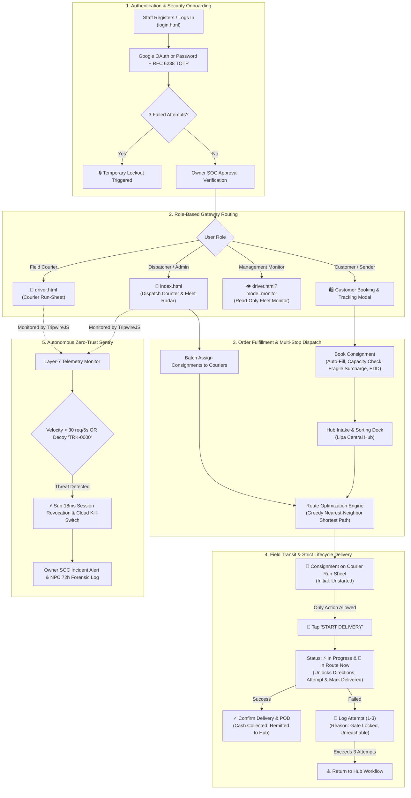

# 🚚 SwiftLogistics Hub

> **A Regional Courier Dispatch & Delivery Management System with Automated Zero-Trust Cybersecurity**  
> *Built for regional freight & logistics • Scalable Serverless Architecture on Google Cloud Platform*  
> *Compliant with the Philippine Data Privacy Act of 2012 (RA 10173) & NPC Circular 16-03*

[](https://swiftlogistics-hub-9821.web.app)
[](https://www.privacy.gov.ph)
[](https://tripwirejs-capstone-9821.web.app)
[](https://github.com/Alessandre-KS/SwiftLogistics)

---

## 📌 Executive Summary & Problem Context

Regional courier branches and freight delivery hubs handle high volumes of sensitive consumer data on a daily basis (full customer names, home delivery addresses, mobile numbers, and substantial Cash-on-Delivery collections). However, commercial enterprise logistics software and cybersecurity suites cost thousands of dollars per month, leaving local regional courier branches vulnerable to:
1. **Manual Inefficiencies & Routing Friction**: Paper waybills, uncoordinated courier assignments, duplicate entries, and lack of shortest-path road route sequencing.
2. **Accidental Premature Deliveries**: Field couriers accidentally marking packages as delivered before even starting transit.
3. **Severe Data Exposure & Scraping**: Credential theft, account hijacking, and automated customer data scraping that lead to regulatory penalties under the **Philippine Data Privacy Act of 2012 (RA 10173)**.

**SwiftLogistics Hub** solves this operational and security dilemma by delivering an end-to-end, role-separated logistics platform with built-in, autonomous cybersecurity operating entirely on Google Cloud Platform's zero-cost serverless tier:
- 🏢 **Branch Dispatch Counter**: Centralized consignment manifest intake, batch driver dispatch, live Fleet Radar GPS telemetry, and transit status sorting.
- 🛍️ **Customer Order Placement & Tracking Portal**: Self-service online booking modal, automated profile data transfer, weight/item capacity limit enforcement, fragile item handling surcharges, dynamic Estimated Delivery Date (EDD) estimation, and privacy-preserving shipment tracking.
- 🛵 **Mobile Courier Transit Run-Sheet**: Field-hardened mobile portal with strict 2-stage delivery lifecycle gating (deliveries must be explicitly started before completion is unlocked), interactive street landmarks/directions, failed attempt logging (1/3 to 3/3), proof of delivery cash tracking, and shortest-path route sequencing.
- 👁️ **Management Courier Fleet Monitor**: Read-only oversight allowing dispatchers to inspect any driver's active route corridor, waypoints, and COD remittances without operational interference.
- 🔐 **Pre-Auth Protection**: RFC 6238 Multi-Factor Authentication (compatible with Google Authenticator) reinforced with 3-strike brute-force lockout limiting and Google OAuth registration.
- 🛡️ **Autonomous Post-Auth Sentry (TripwireJS)**: Sub-18ms automated breach containment using honeypot decoys (`TRK-0000`) and query velocity triggers that sever compromised sessions instantly and produce National Privacy Commission (NPC) 72-hour breach forensic documentation.

---

## 🌐 The 4 Core Integrated Portals

| Portal | Primary User | Live Production Link | Key Architectural Capabilities |
| :--- | :--- | :--- | :--- |
| **🏢 Branch Dispatch Desk** | Dispatchers & Branch Clerks | [Launch Dispatch Desk](https://swiftlogistics-hub-9821.web.app/index.html) | • Waybill encoding & manifest table (`manifest.html`)<br>• Batch multi-parcel courier assignment<br>• Real-time Fleet Radar with live courier coordinates & route paths<br>• Dropdown transit status filtering (All Fleet, Hub Sorting, Out for Delivery, Delivered)<br>• Customer phone number masking (`0917-***-1146`)<br>• Leaflet.js interactive hub map with draggable street/purok precision pinning |
| **🛍️ Customer Order & Tracking** | Senders & Consignment Customers | [Open Customer Portal](https://swiftlogistics-hub-9821.web.app/index.html) | • Self-service single-page booking modal with user profile auto-fill<br>• Capacity limit enforcement (max 50 kg / 20 items per order)<br>• Fragile item handling surcharge (+₱75 fee with warning tags)<br>• Dynamic Estimated Delivery Date (EDD) based on hub distance<br>• Standardized high-contrast UI action buttons & Terms of Service modal<br>• Privacy-preserving personal order tracking history |
| **🛵 Courier Transit Run-Sheet** | Field Riders & Truck Drivers | [Launch Courier Run-Sheet](https://swiftlogistics-hub-9821.web.app/driver.html) | • Mobile-first responsive run-sheet ($\le 640\text{px}$ compact header, zero clipping)<br>• Strict 2-stage delivery gating: `🚀 START DELIVERY` must precede delivery completion<br>• Traveling Salesperson route optimization (`⭐ Best Stop #1`)<br>• Interactive house directions with wayfinding landmarks & Google Maps links<br>• Failed attempt tracking (1/3, 2/3, 3/3) with reason capture & max attempt return flags<br>• Proof of Delivery (POD) cash collection and recipient handoff logging<br>• Read-only **Courier Fleet Monitor** mode for branch dispatchers |
| **🛡️ Owner Security Console (SOC)** | Business Owner (Bossing Jeff) | [Launch SOC Console](https://tripwirejs-capstone-9821.web.app) | • Approve/reject staff registration requests & issue Google Authenticator QR passes<br>• View employee 2FA MFA secrets protected behind administrator passkey<br>• Real-time query velocity gauge & synthetic honeypot decoy (`TRK-0000`)<br>• Instant cloud Firestore security rules kill-switch<br>• Automated pre-filled NPC 72-Hour Breach Forensic Report generation |

---

## 🔄 End-to-End System Workflow Architecture



---

## 🛠️ Detailed Feature Highlights & Technical Breakdown

### 1. Strict Two-Stage Delivery Lifecycle
To eliminate accidental premature deliveries in the field, `driver.html` strictly gates the delivery workflow:
* **Stage 1 (Unstarted Consignment)**: When a package is assigned to a courier, the card renders **only** `🚀 START DELIVERY` and `🏠 Directions`. The `✓ Mark Delivered` and `🔄 Attempt` actions are completely hidden from the DOM. Direct modal calls are guarded at the functional level.
* **Stage 2 (In Transit)**: Once the courier taps `🚀 START DELIVERY`, transit is formally initiated (`parcel.deliveryStarted = true`), updating the card to `⚡ In Progress` and `🛵 In Route Now`. This unlocks `🏠 Directions`, `🔄 Attempt`, and `✓ Mark Delivered`.
* **Stage 3 (Delivery Hand-off & POD)**: The courier records cash collected, logs recipient details, and confirms the delivery. The `🛵 In Route Now` badge is immediately cleared, and the consignment displays `✓ Remitted to Lipa Branch Counter`.

### 2. Multi-Stop Route Optimization Engine
* Field couriers frequently carry multiple consignments across Lipa City.
* The system features an automated **Traveling Salesperson Route Optimization Engine** (greedy nearest-neighbor shortest-path algorithm) anchored from the Lipa Central Hub (`13.9692° N, 121.1594° E`) or the courier's live broadcasted coordinates.
* Automatically recalculates driving distances via the Haversine formula, reorders waypoints to minimize total kilometers, highlights `⭐ Best Stop #1`, and provides interactive turn-by-turn routing via Open Source Routing Machine (OSRM).

### 3. Customer Order Placement & Tracking Portal
* **Automated Profile Transfer**: Pre-populates logged-in user names, contact details, and default addresses into booking fields.
* **Order Capacity Constraints**: Enforces physical logistics boundaries (maximum 50 kg package weight and 20 individual items per order booking).
* **Fragile Item Surcharge**: Automatically appends a ₱75 special handling fee when "Fragile / Breakable Cargo" is selected, updating totals and adding alert badges to waybills.
* **Dynamic EDD Calculation**: Estimates delivery completion based on origin hub distance, parcel volume, and local dispatch cutoff windows.
* **Single-Page Modal Architecture**: Streamlines checkout, tracking, and account management without full page reloads.

### 4. Zero-Trust Autonomous Cybersecurity (TripwireJS)
* **RFC 6238 TOTP Engine**: Native client-side Web Crypto API TOTP implementation with 30-second rotating cryptographic tokens.
* **OTP Attempt Limiting & Brute-Force Lockout**: Restricts invalid passkey attempts to 3 consecutive failures before enforcing a temporary account lockout.
* **Synthetic Honeypot (`TRK-0000`)**: Planted directly in the database. Any automated scraping script traversing tracking identifiers triggers immediate containment.
* **Sub-18ms Session Revocation**: Injects immediate client-side session revocation and propagates cloud quarantine rules without requiring dedicated backend server daemons.
* **Philippine Data Privacy Act (RA 10173)**: All recipient mobile numbers are masked (`0917-***-1146`) across public screens, and field couriers are strictly restricted to viewing only their assigned consignments.

### 5. Mobile-Optimized Field Architecture
* Tailored for courier smartphones ($\le 640\text{px}$ and $\le 420\text{px}$).
* Features compact single-row topbars with prioritized actions, preventing button clipping and guaranteeing that **"Sign Out"** and navigation controls remain 100% accessible.
* Worker-first design removes dependency on customer-presented QR codes for delivery handoff.

---

## 📁 Repository Structure

```text
├── index.html                  # Management Dispatch Desk, Fleet Radar, & Customer Booking Portal
├── driver.html                 # Dedicated Courier Transit Terminal & Read-Only Management Fleet Monitor
├── manifest.html               # Counter Waybill Intake Encoder (Printable consignment notes & barcodes)
├── login.html                  # Two-Factor Authentication Gateway (TOTP, Google OAuth, & Brute-Force Lockout)
├── app.js                      # Core business logic: Central Hub geolocations, Firestore sync, route optimization, & orders
├── totp.js                     # Standalone RFC 6238 TOTP Web Crypto implementation
├── driver.css                  # Mobile-first courier stylesheet & responsive breakpoint rules
├── style.css                   # Enterprise dispatch counter stylesheet & high-contrast UI system
├── firebase.json               # Firebase Hosting configuration & caching headers
├── firestore.rules.example     # Declarative Cloud Firestore security rules with Tripwire quarantine hooks
├── firebase-config.example.js  # Template configuration for Firebase credentials
├── SwiftLogistics_Strategic_IS_Development_Plan.docx # Academic Capstone SISDP Word Document
└── TripwireJS/                 # Owner SOC Security Console (Telemetry, quarantine kill-switch, approvals)
    ├── index.html              # SOC Dark-mode command console
    ├── app.js                  # Threat logging, forensic telemetry & staff account management
    └── tripwire.js             # TripwireJS Layer-7 Sentry & containment engine
```

---

## 🚀 Quick Start (Local Setup & Evaluation)

### 1. Clone the Repository
```bash
git clone https://github.com/Alessandre-KS/SwiftLogistics.git
cd SwiftLogistics
```

### 2. Configure Firebase Credentials
Copy the example config template and provide your Firebase project API keys:
```bash
# On Windows (PowerShell)
Copy-Item firebase-config.example.js firebase-config.js
```

### 3. Launch Local Server
Serve the project using any local HTTP static server:
```bash
npx serve .
# Open http://localhost:3000/login.html in your browser
```

---

## 🎯 Capstone Defense Walkthrough (5-Minute Script)

1. **Step 1: Role Segregation & Authentication (1 min)**:
   - On `login.html`, demonstrate login with 2FA TOTP verification. Show the 3-attempt OTP lockout guard.
   - Show Google OAuth integration on the registration modal.
   - Show role routing: Staff with dispatcher roles land on `index.html`; couriers land on `driver.html`.

2. **Step 2: Customer Order Placement & Dispatch Booking (1 min)**:
   - On `index.html`, open the **"Place Delivery Order"** modal.
   - Show user data auto-fill, weight/item capacity check, fragile handling surcharge (+₱75), and dynamic EDD calculation.
   - Submit order and inspect the new consignment appearing in the dispatch manifest.

3. **Step 3: Route Optimization & Batch Dispatch (1 min)**:
   - Select multiple consignments for Lipa City and assign them to an active motorcycle courier.
   - Demonstrate the traveling salesperson algorithm reordering stops for shortest total distance (`⭐ Best Stop #1`).
   - Show live courier GPS markers on the interactive Leaflet **Fleet Radar**.

4. **Step 4: Field Courier Transit & Strict Delivery Lifecycle (1 min)**:
   - Switch to `driver.html` (or open on mobile browser).
   - Point out that `Mark Delivered` is initially locked. Tap `🚀 START DELIVERY` to initiate transit.
   - Open **House Directions** to view landmark wayfinding cues.
   - Complete the delivery via **"Confirm Delivery & POD"**, collect COD, and observe `In Route Now` clearing cleanly.
   - Demonstrate management view-only mode (`👁️ Monitoring Run`).

5. **Step 5: TripwireJS Automated Cyber Defense & SOC Report (1 min)**:
   - On the Dispatch Desk, execute a rapid query burst (>30 requests in 5 seconds) or query honeypot decoy `TRK-0000`.
   - Observe instant session termination in under 18 milliseconds (`🚫 Session Terminated by TripwireJS`).
   - Switch to the **Owner SOC Console** (`TripwireJS/index.html`): display the alert banner, cloud quarantine status, and pre-filled NPC 72-Hour Breach Forensic Report.

---

## 🎓 Academic Attribution & Credits
* **Project**: SwiftLogistics Hub
* **Program**: Bachelor of Science in Information Technology (BSIT)
* **Course**: Information Assurance & Security (IAS) Capstone Project
* **Institution**: University of Batangas — Lipa City Campus
* **Live Web App**: [https://swiftlogistics-hub-9821.web.app](https://swiftlogistics-hub-9821.web.app)
* **Owner SOC**: [https://tripwirejs-capstone-9821.web.app](https://tripwirejs-capstone-9821.web.app)
