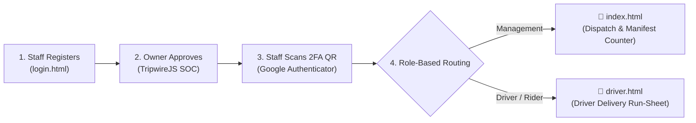

# 🚚 SwiftLogistics Hub

> **A Regional Courier Dispatch & Delivery Management System with Automated Zero-Trust Cybersecurity**  
> *Built for Philippine MSME logistics • 100% Free Tier (₱0.00 infrastructure cost) on Google Cloud Platform*  
> *Compliant with the Philippine Data Privacy Act of 2012 (RA 10173) & NPC Circular 16-03*

---

## 📌 What is SwiftLogistics Hub?

Regional couriers and delivery branches handle sensitive customer data every day (names, phone numbers, home addresses, and cash-on-delivery amounts). However, commercial enterprise cybersecurity tools cost thousands of dollars per month—leaving local couriers vulnerable to credential theft, account hijacking, and automated customer data scraping.

**SwiftLogistics Hub** solves this by providing a complete, role-separated logistics management system with built-in cybersecurity at zero operational cost:
- 🏢 **Role Separation**: Dedicated hubs for **Branch Management** (desktop dispatch counter) and **Delivery Drivers** (mobile-friendly transit run-sheet).
- 🔐 **Pre-Auth Protection**: RFC 6238 Multi-Factor Authentication (compatible with Google Authenticator).
- 🛡️ **Post-Auth Defense**: **TripwireJS** automated sentry that detects scraping and severs compromised sessions in under 18 milliseconds.

---

## 🌐 The 3 Portals at a Glance

| Portal | Intended User | Live Link | Key Capabilities |
| :--- | :--- | :--- | :--- |
| **🏢 Branch Dispatch Desk** | Dispatchers & Counter Clerks | [Launch Dispatch Desk](https://swiftlogistics-hub-9821.web.app/index.html) | • Manifest new waybills (`manifest.html`)<br>• Sort packages by status (Hub Sorting, Out for Delivery, Delivered)<br>• Assign shipments to Motorcycle or Cargo Truck couriers<br>• Customer phone number masking (RA 10173) |
| **🛵 Driver Transit Hub** | Delivery Riders & Truck Drivers | [Launch Driver Run-Sheet](https://swiftlogistics-hub-9821.web.app/driver.html) | • Mobile-first run-sheet of assigned stops<br>• 1-tap `📞 Call Recipient` & `📍 Map Directions`<br>• 1-tap **"✓ Mark Consignment as Delivered"** & POD logging<br>• Real-time Cash on Delivery (COD) collection tracking |
| **🛡️ Owner Security Console (SOC)** | Business Owner (Bossing Jeff) | [Launch SOC Console](https://tripwirejs-capstone-9821.web.app) | • Approve/reject prospective staff registration requests<br>• View employee 2FA Authenticator QR codes & delete accounts<br>• Real-time query velocity gauge & canary honeypot (`TRK-0000`)<br>• Instant cloud kill-switch & pre-filled NPC 72-Hour Breach Forensic Report |

---

## 🔄 How the System Works (End-to-End)



1. **Staff Onboarding**: A staff member registers on `login.html` with their corporate email, mobile number, role, and vehicle category (Motorcycle Express or Cargo Truck Heavy).
2. **Owner Approval**: Bossing Jeff verifies the registration on the Owner Console (`TripwireJS`), provisioning the account into Cloud Firestore `/staff`.
3. **2FA Enrollment & Login**: The staff member enters their password, scans their unique QR code into Google Authenticator, and inputs the 6-digit TOTP code.
4. **Role-Based Workspaces**:
   - **Dispatchers** land on `index.html` to book parcels and assign shipments to riders.
   - **Drivers** land on `driver.html` to see only their assigned stops and record completed deliveries.

---

## 🛡️ Built-In Cybersecurity Features (Plain English)

### 1. Two-Factor Authentication (2FA / TOTP)
- Uses the industry-standard **RFC 6238** algorithm with a 30-second rotating window.
- Compatible with **Google Authenticator**, **Microsoft Authenticator**, and **Authy**.
- Neutralizes stolen passwords and automated bots before they can access company data.

### 2. TripwireJS Automated Breach Containment
- **Velocity Rate Limiting**: If an account requests more than 30 queries in 5 seconds (indicating an automated scraper or compromised session), TripwireJS blocks the browser in ~18ms.
- **Honeypot Decoy (`TRK-0000`)**: A synthetic waybill is planted in the database. Anyone querying it is instantly identified as an attacker.
- **Zero-Cost Cloud Kill-Switch**: Compromised accounts are automatically quarantined via Cloud Firestore Security Rules, cutting off database access worldwide without requiring a backend server.

### 3. Data Privacy Compliance (RA 10173)
- **Principle of Least Privilege**: Drivers only see the packages on their delivery route, not the entire branch customer directory.
- **Customer PII Masking**: Customer contact numbers are automatically masked (`0917-***-1146`) to prevent visual shoulder-surfing.

---

## 🎯 Capstone Defense Demonstration Guide

Follow this 5-minute walkthrough to demonstrate the system to your panel:

1. **Show Driver & Dispatcher Separation**:
   - Log in as **Bossing Jeff** or a Dispatcher $\rightarrow$ lands on the **Dispatch Counter** (`index.html`) to show waybill creation and dispatching.
   - Log in as a **Driver** $\rightarrow$ automatically routes to the **Driver Transit Hub** (`driver.html`) showing active stops and 1-tap "Mark Delivered".
2. **Show Staff Registration & Owner Approval**:
   - On `login.html`, click **"Register as New Staff"**, enter test details, and submit.
   - On the **Owner SOC Console**, show the new request appearing in the **Pending Registrations** queue. Click **Verify & Approve** to generate their authenticator QR code.
3. **Show Automated Attack Containment**:
   - On the Dispatch Desk, perform a burst lookup or query the decoy tracking number (`TRK-0000`).
   - Observe the instant session revocation (`🚫 Session Terminated by TripwireJS`).
   - Switch to the Owner SOC Console: show the breach alert, the 99%+ data preservation rate, and the pre-filled NPC 72-Hour Breach Forensic Report.
4. **Recover Account**:
   - On the Owner Console, click **Re-activate Staff** to restore access immediately.

---

## 📁 Repository Structure

```text
├── index.html            # Management Dispatch Terminal (Waybill tracking, sorting, fleet dispatch)
├── manifest.html         # Counter Waybill Encoder (Printable consignment notes & barcode generation)
├── driver.html           # Dedicated Driver Transit Terminal (Mobile-friendly route run-sheet & POD)
├── login.html            # Two-Factor Authentication gateway (Google Authenticator TOTP verification)
├── app.js                # Core logistics logic, Firestore sync, and role-based session management
├── totp.js               # Standalone RFC 6238 TOTP Web Crypto implementation
├── style.css             # Courier freight design system
├── firestore.rules       # Cloud Firestore security rules (Role validation & kill-switch)
├── firebase.json         # Firebase Hosting configuration & caching headers
└── TripwireJS/           # Owner SOC Security Console (Telemetry, quarantine kill-switch, approvals)
    ├── index.html        # SOC Dark-mode command console
    ├── app.js            # Threat logging, forensic telemetry & staff account management
    ├── firestore.rules   # Security rules for threat logs and owner operations
    └── tripwire.js       # TripwireJS Layer-7 Sentry & containment engine
```

---

## 🎓 Academic Attribution & Credits
- **Project**: SwiftLogistics Hub (Branch #04 Regional Dispatch Desk)
- **Institution**: University of Batangas – Lipa City (UB-Lipa CITEC)
- **Program**: Bachelor of Science in Information Technology (BSIT)
- **Course**: Information Assurance & Security (IAS) Capstone Project
