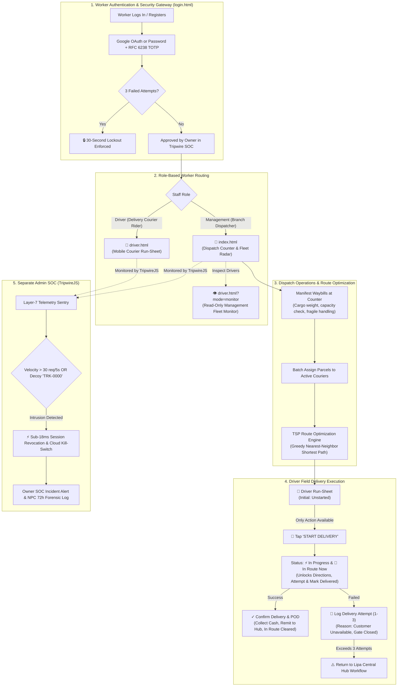

# 🚚 SwiftLogistics Hub

> **A Regional Courier Dispatch & Delivery Management System with Automated Zero-Trust Cybersecurity**  
> *Built strictly for logistics field operations: Drivers & Branch Management, with isolated Admin SOC at Tripwire*  
> *Scalable Serverless Architecture on Google Cloud Platform • Compliant with Philippine Data Privacy Act (RA 10173)*

[](https://swiftlogistics-hub-9821.web.app)
[](https://www.privacy.gov.ph)
[](https://tripwirejs-capstone-9821.web.app)
[](https://github.com/Alessandre-KS/SwiftLogistics)

---

## 📌 Executive Summary & System Boundary

**SwiftLogistics Hub** is a specialized, role-segregated regional freight dispatch and delivery management web application designed strictly for **logistics workforce operations**:
- **Field Couriers & Riders (Drivers)**: Mobile transit run-sheet, strict delivery lifecycle gating, turn-by-turn road navigation, and Proof of Delivery (POD) cash remittance.
- **Branch Dispatchers & Clerks (Management)**: Centralized waybill intake, batch driver dispatch, live Fleet Radar GPS telemetry, and view-only fleet monitoring.
- **Owner & Security Administrator (Admin — Isolated at Tripwire)**: High-privilege administrative governance, account provisioning, and threat containment hosted separately on the **TripwireJS Security Operations Console (SOC)**.

> [!IMPORTANT]
> **No Customer Functions**: This system is exclusively an internal operations and fleet fulfillment platform for enterprise workers. Customers do not access or log into the application; customer waybill handoffs are executed directly by field drivers and counter clerks.

---

## 🌐 The 3 Isolated Operational Environments

| Environment | Primary User | Access Endpoint | Core Capabilities |
| :--- | :--- | :--- | :--- |
| **🏢 Management Dispatch Desk** | Branch Dispatchers & Counter Clerks | [Launch Dispatch Desk](https://swiftlogistics-hub-9821.web.app/index.html) | • Waybill intake & consignment manifesting (`manifest.html` & `index.html`)<br>• Batch parcel assignment to motorcycle or cargo truck couriers<br>• Real-time Fleet Radar with live courier GPS coordinates & delivery corridors<br>• Dropdown transit status filtering (`All Fleet`, `Hub Sorting`, `Out for Delivery`, `Delivered`)<br>• Customer phone number masking (`0917-***-1146`) under RA 10173<br>• Interactive Leaflet map with draggable street/purok precision pinning |
| **🛵 Driver Transit Hub** | Field Couriers, Riders, & Truck Drivers | [Launch Courier Run-Sheet](https://swiftlogistics-hub-9821.web.app/driver.html) | • Mobile-first responsive run-sheet ($\le 640\text{px}$ compact header, zero button clipping)<br>• Strict 2-stage delivery gating: `🚀 START DELIVERY` must precede delivery completion<br>• Multi-stop Traveling Salesperson route optimization (`⭐ Best Stop #1`)<br>• Interactive house directions with wayfinding landmarks & Google Maps navigation<br>• Delivery attempt logging (1/3, 2/3, 3/3) with failure reasons & max-attempt return flags<br>• Proof of Delivery (POD) cash collection handoff (clears `In Route Now`)<br>• Read-only **Courier Fleet Monitor** mode for branch management |
| **🛡️ Owner SOC Security Console** | Business Owner & System Admin | [Launch SOC Console](https://tripwirejs-capstone-9821.web.app) | • **Completely separate administrative application**<br>• Approve/reject staff registration requests & issue Google Authenticator QR passes<br>• Admin passkey-gated 2FA secret vault & staff account management<br>• Real-time query velocity gauge & synthetic honeypot decoy (`TRK-0000`)<br>• Instant cloud Firestore security rules kill-switch & pre-filled NPC 72-Hour Breach Report |

---

## 🔄 End-to-End System Workflow Architecture



---

## 🛠️ Core Functional Modules (Driver & Management)

### 1. Strict Two-Stage Delivery Lifecycle (Driver)
Field couriers can never accidentally complete a delivery prior to starting the run:
* **Stage 1 (Unstarted Consignment)**: When assigned, run-sheet cards render **only** `🚀 START DELIVERY` and `🏠 Directions`. Neither `✓ Mark Delivered` nor `🔄 Attempt` is visible or accessible.
* **Stage 2 (In Transit)**: Tapping `🚀 START DELIVERY` begins transit (`deliveryStarted = true`), updating the card to `⚡ In Progress` and `🛵 In Route Now`. This unlocks `🏠 Directions`, `🔄 Attempt`, and `✓ Mark Delivered`.
* **Stage 3 (Delivery Hand-off & Cash Collection)**: The courier confirms cash collected, records the recipient name, and logs delivery proof. The `🛵 In Route Now` badge is immediately cleared, and status transitions to `✓ Remitted to Lipa Branch Counter`.

### 2. Multi-Stop Traveling Salesperson Route Optimization
* For couriers carrying multiple parcels, the system executes an automated **Traveling Salesperson algorithm** (greedy nearest-neighbor shortest-path optimization) anchored at Lipa Central Hub (`13.9692° N, 121.1594° E`) or the courier's live broadcasted coordinates.
* Sequences delivery waypoints to minimize driving distance, flags `⭐ Best Stop #1`, and provides turn-by-turn road geometry routing via OSRM.

### 3. Management Fleet Radar & Dispatch Desk (Management)
* **Consignment Intake & Manifesting**: Branch clerks book shipments, calculate freight fees, verify weight/item capacity constraints (50 kg / 20 items max), and apply fragile surcharges (+₱75).
* **Batch Multi-Consignment Dispatch**: One-click assignment of queued parcels to motorcycle or truck couriers.
* **Live Fleet Radar**: Real-time Leaflet.js radar displaying couriers' active GPS positions and route corridors.
* **Read-Only Courier Fleet Monitor**: Dispatchers can open any courier's active run-sheet in read-only mode (`👁️ Monitoring Run`) to inspect live stops, waypoints, and cash collections without operational control buttons.

### 4. Separate Admin SOC & Autonomous Cyber Defense (TripwireJS)
* **Isolated Administrative Domain**: The admin security console is decoupled from the main logistics app and hosted at `https://tripwirejs-capstone-9821.web.app`.
* **RFC 6238 TOTP Engine**: Web Crypto API TOTP with Google Authenticator verification.
* **3-Strike OTP Lockout Guard**: Restricts failed passkey attempts to 3 consecutive tries before enforcing a temporary account lockout.
* **Honeypot Decoy (`TRK-0000`)**: Traps automated bot crawlers traversing tracking numbers.
* **Sub-18ms Session Revocation**: Kills compromised sessions instantaneously and activates declarative Firestore security rules to quarantine malicious accounts worldwide.

---

## 📁 Repository Structure

```text
├── index.html                  # Management Dispatch Desk, Fleet Radar, & Sorting Facility
├── driver.html                 # Dedicated Courier Transit Terminal & Read-Only Management Fleet Monitor
├── manifest.html               # Counter Waybill Intake Encoder (Printable consignment notes & barcodes)
├── login.html                  # Staff Two-Factor Authentication Gateway (TOTP, Google OAuth, & Lockout)
├── app.js                      # Core business logic: Central Hub geolocations, Firestore sync, & route optimization
├── totp.js                     # Standalone RFC 6238 TOTP Web Crypto implementation
├── driver.css                  # Mobile-first courier stylesheet & responsive breakpoint rules
├── style.css                   # Enterprise dispatch counter stylesheet & high-contrast UI system
├── firebase.json               # Firebase Hosting configuration & caching headers
├── firestore.rules.example     # Declarative Cloud Firestore security rules with Tripwire quarantine hooks
├── firebase-config.example.js  # Template configuration for Firebase credentials
├── SwiftLogistics_Strategic_IS_Development_Plan.docx # Academic Capstone SISDP Word Document
└── TripwireJS/                 # Isolated Admin SOC Security Console (Telemetry, quarantine kill-switch, approvals)
    ├── index.html              # SOC Dark-mode command console
    ├── app.js                  # Threat logging, forensic telemetry & staff account management
    └── tripwire.js             # TripwireJS Layer-7 Sentry & containment engine
```

---

## 🚀 Quick Start (Local Setup & Evaluation)

### 1. Clone the Repository
```bash
git clone https://github.com/Alessandre-KS/SwiftLogistics.git
cd SwiftLogistics
```

### 2. Configure Firebase Credentials
```bash
# On Windows (PowerShell)
Copy-Item firebase-config.example.js firebase-config.js
```

### 3. Launch Local Server
```bash
npx serve .
# Open http://localhost:3000/login.html in your browser
```

---

## 🎯 Capstone Defense Walkthrough (5-Minute Script)

1. **Step 1: Role Segregation & Authentication (1 min)**:
   - On `login.html`, demonstrate login with 2FA TOTP verification. Show the 3-attempt OTP lockout guard.
   - Show role-based routing: **Management (Branch Dispatcher)** routes to `index.html`; **Driver (Delivery Courier)** routes to `driver.html`.
   - Point out that Admin is separated at the **Tripwire SOC Console**.

2. **Step 2: Dispatch Intake & Batch Courier Assignment (1 min)**:
   - On `index.html`, open **"Manifest New Shipment"**.
   - Input consignment details, cargo weight, fragile handling (+₱75), and save waybill to manifest.
   - Select multiple consignments and batch-assign them to an active motorcycle courier.

3. **Step 3: Route Optimization & Fleet Radar (1 min)**:
   - Observe the greedy nearest-neighbor TSP algorithm reordering stops for shortest total distance (`⭐ Best Stop #1`).
   - Show live courier GPS markers on the interactive Leaflet **Fleet Radar**.

4. **Step 4: Driver Transit & Strict Delivery Lifecycle (1 min)**:
   - Switch to `driver.html` (mobile view).
   - Point out that `Mark Delivered` is initially locked. Tap `🚀 START DELIVERY` to initiate transit.
   - Open **House Directions** to view landmark wayfinding cues.
   - Complete the delivery via **"Confirm Delivery & POD"**, collect COD, and observe `In Route Now` clearing cleanly.
   - Switch to management mode (`driver.html?mode=monitor`) to show read-only oversight (`👁️ Monitoring Run`).

5. **Step 5: TripwireJS Automated Cyber Defense at Isolated Admin SOC (1 min)**:
   - On the Dispatch Desk, execute a rapid query burst (>30 requests in 5 seconds) or query honeypot decoy `TRK-0000`.
   - Observe instant session termination in under 18 milliseconds (`🚫 Session Terminated by TripwireJS`).
   - Switch to the **Owner SOC Console** (`TripwireJS/index.html`): display the alert banner, cloud quarantine status, and pre-filled NPC 72-Hour Breach Forensic Report.

---

## 🎓 Academic Attribution & Credits
* **Project**: SwiftLogistics Hub
* **Program**: Bachelor of Science in Information Technology (BSIT)
* **Course**: Information Assurance & Security (IAS) Capstone Project
* **Institution**: University of Batangas — Lipa City Campus
* **Live Dispatch & Driver Web App**: [https://swiftlogistics-hub-9821.web.app](https://swiftlogistics-hub-9821.web.app)
* **Isolated Admin SOC Console**: [https://tripwirejs-capstone-9821.web.app](https://tripwirejs-capstone-9821.web.app)
