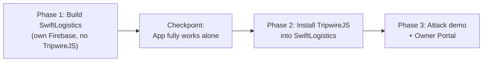

# SwiftLogistics Hub — Standalone Project Instructions

> **Core rule:** SwiftLogistics Hub is a **separate business** owned by an entrepreneur. It gets its **own Firebase project**, its own data, its own login, and it must **work completely on its own first**.
> Only after that is **TripwireJS** added as a third-party security product.
>
> Think of it like a store that installs a CCTV system. The store exists first; the CCTV vendor is a different company.

---

## 1. The Two Entities

| | **SwiftLogistics Hub** (the client) | **TripwireJS** (the security vendor) |
| :--- | :--- | :--- |
| **What it is** | A small courier business (MSME) | A data breach containment product |
| **Owner** | Aling Nena (entrepreneur / business owner) | The capstone team (vendor) |
| **Users** | Staff: Maria Santos (Dispatcher), Carlo Reyes (Rider) | Aling Nena uses the TripwireJS Owner Portal |
| **Firebase project** | **Its own new project**, e.g. `swiftlogistics-hub-XXXX` | `tripwirejs-capstone-9821` (vendor demo / owner portal hosting) |
| **Folder** | `w:\IAS CAPSTONE\SwiftLogisticsHub\` | `w:\IAS CAPSTONE\TripwireJS\` |
| **Owns the customer data?** | ✅ Yes, it's the business's data | ❌ No. It only watches access and stores threat logs |

> [!IMPORTANT]
> TripwireJS **never holds** SwiftLogistics' customer records. Customer data lives only in SwiftLogistics' own Firestore. TripwireJS gets **installed into** the client's Firebase project (rules + threat log collections). It does not copy the data out.

---

## 2. Build Order (Strict)



Do **not** start Phase 2 until the Phase 1 checkpoint passes.

---

## 3. Phase 1: SwiftLogistics as a Standalone Business App

### 3.1 Create its own Firebase project (Spark free plan, ₱0)
1. Firebase Console → **Add project** → name: `SwiftLogistics Hub`.
2. **No billing account.** Stay on the **Spark** plan.
3. Register a **Web App** and copy its `firebaseConfig`.
4. Enable **Authentication → Email/Password**.
5. Create **Cloud Firestore** (production mode, region `asia-southeast1`).
6. Enable **Hosting**.

### 3.2 Create the staff accounts (Firebase Auth)
| Email | Role | UID doc in `staff/` |
| :--- | :--- | :--- |
| `maria.santos@swiftlogistics.ph` | Branch Dispatcher | `staff/{maria_uid}` |
| `carlo.reyes@swiftlogistics.ph` | Delivery Rider | `staff/{carlo_uid}` |
| `nena@swiftlogistics.ph` | Owner | `staff/{nena_uid}` |

### 3.3 Firestore data model (business data only)
```
parcels/{trackingNo}
    name, phone (masked for display), city, package, cod, status, createdAt
staff/{uid}
    name, role ("dispatcher" | "rider" | "owner"), email
```
- Seed `parcels` with the **UB-Lipa CITEC sample people** already used (Alessandre Kyle Sanidad `TRK-8812`, Samantha Jean Adaya `TRK-9042`, …).
- **No** `threat_logs`, **no** canary record, **no** velocity fields. Those belong to TripwireJS (Phase 2).

### 3.4 Security rules (business-only baseline)
Staff must be logged in and exist in `staff/` to read or write parcels. Everyone else is denied.

```javascript
// ILLUSTRATIVE ONLY. Have the real firestore.rules authored and reviewed by the rules specialist.
rules_version = '2';
service cloud.firestore {
  match /databases/{db}/documents {
    function isStaff() {
      return request.auth != null
        && exists(/databases/$(db)/documents/staff/$(request.auth.uid));
    }
    match /parcels/{id} { allow read, write: if isStaff(); }
    match /staff/{uid}   { allow read: if request.auth != null && request.auth.uid == uid; }
    match /{document=**} { allow read, write: if false; }
  }
}
```

### 3.5 Required app files (SwiftLogistics folder)
```
SwiftLogisticsHub/
├── login.html          ← Firebase Auth sign-in (real, not mocked)
├── index.html          ← Dispatch desk: KPIs, track & trace, manifest, book parcel, update status
├── app.js              ← Business logic: Firebase init, auth, parcels CRUD (Firestore)
├── style.css           ← SwiftLogistics' own styles only
├── firebase.json       ← Points to SwiftLogistics' own project
├── .firebaserc         ← { "projects": { "default": "swiftlogistics-hub-XXXX" } }
├── firestore.rules     ← Business baseline rules (3.4)
└── README.md
```

### 3.6 ✅ Phase 1 Checkpoint (must all pass)
- [ ] Staff can **log in / log out** with real Firebase Auth.
- [ ] Parcels load from **SwiftLogistics' own Firestore** (not a hardcoded array).
- [ ] Book new parcel → saved to Firestore → visible after page refresh on another browser.
- [ ] Update status → saved to Firestore.
- [ ] Logged-out user cannot read `parcels` (test in Rules Playground).
- [ ] Deployed to `https://swiftlogistics-hub-XXXX.web.app`.
- [ ] Searching the folder for the word `tripwire` returns **zero results**.

---

## 4. Phase 2: Install TripwireJS into SwiftLogistics

This is where the defense story happens: *"Here is a normal business. Now watch what installing TripwireJS adds."*

### 4.1 What TripwireJS adds to the client's Firebase project
| Added piece | Where | Purpose |
| :--- | :--- | :--- |
| `staff/{uid}.status` field (`"active"` / `"quarantined"`) | SwiftLogistics Firestore | The **kill-switch**. Rules deny all access when quarantined |
| `threat_logs/{id}` collection | SwiftLogistics Firestore | Immutable breach audit trail (owner-read only) |
| `system_config/tripwire` doc | SwiftLogistics Firestore | Burst limit (30 / 5s), canary ID, owner phone |
| `parcels/TRK-0000` canary record | SwiftLogistics Firestore | Honeypot decoy. Any read = instant quarantine |
| `tripwire.js` SDK (one `<script>` tag) | SwiftLogistics `index.html` | Client-side velocity monitor + lockout screen |
| Cloud Function gateway (optional, see 4.3) | SwiftLogistics Functions | Server-side detection + `revokeRefreshTokens(uid)` |

### 4.2 The rules change is small (this is the selling point)
```javascript
// ILLUSTRATIVE ONLY. Added by TripwireJS installation.
function notQuarantined() {
  return get(/databases/$(db)/documents/staff/$(request.auth.uid)).data.status == 'active';
}
match /parcels/{id} { allow read, write: if isStaff() && notQuarantined(); }
match /threat_logs/{id} { allow read: if isOwner(); allow write: if false; }
```
Flipping one field (`status: "quarantined"`) blocks the stolen session on its next request, **on the free Spark plan, with no server code.**

### 4.3 ⚠️ Free-tier reality: Cloud Functions
> [!WARNING]
> **Deploying Cloud Functions requires the Blaze plan** (billing account attached). Spark cannot deploy functions.

Since this project must stay ₱0 with no billing, use this split:

| Mode | Detection | Kill-switch | Use for |
| :--- | :--- | :--- | :--- |
| **Live (Spark)** | `tripwire.js` in the browser | Firestore rules `status` check (4.2) | Hosted demo site |
| **Emulator (local, free)** | Cloud Function gateway in **Firebase Emulator Suite** | `revokeRefreshTokens(uid)` + rules | Panel defense of the real architecture |

**Be honest with the panel:** browser-side detection can be bypassed by an attacker calling Firestore directly with `curl`. The production design is the Cloud Function gateway, which runs on the Emulator for this capstone because of the free-tier limit.

### 4.4 Integration contract (what the client gives TripwireJS)
The installation should need **only** these values. If TripwireJS needs anything else hardcoded, the separation is broken.
```javascript
TripwireJS.init({
  firebaseApp: app,                 // SwiftLogistics' own initialized Firebase app
  protectedCollection: "parcels",
  staffCollection: "staff",
  canaryId: "TRK-0000",
  burstLimit: 30,
  burstWindowSec: 5,
  ownerAlertPhone: "+63 9XX XXX XXXX"
});
```

### 4.5 Owner Portal connection
- The TripwireJS Owner Portal (`TripwireJS/index.html`) signs Aling Nena in **to SwiftLogistics' Firebase project** (she is the owner there) and reads `threat_logs` + `staff` from it.
- The 31 affected customers list must come from `threat_logs`, **not** from a hardcoded array in `TripwireJS/app.js`.

---

## 5. What Must Change in the Current Code

The current prototype mixes the two entities. Fix these:

| # | Current problem | Fix |
| :--- | :--- | :--- |
| 1 | `SwiftLogisticsHub/tripwire.js` holds the **customer DATABASE**, `login()`, `addParcel()`, `updateParcelStatus()` | Move all business logic into `SwiftLogisticsHub/app.js` backed by Firestore. `tripwire.js` keeps **only** security logic |
| 2 | Login is mocked (`localStorage`, any password works) | Replace with Firebase Auth `signInWithEmailAndPassword` |
| 3 | `TripwireJS/app.js` hardcodes `victimsList` (the 30 students) | Read affected records from `threat_logs` in the client's Firestore |
| 4 | `TripwireJS/tripwire.js` is a stale copy of the SDK | Keep **one** source copy of the SDK. SwiftLogistics includes it, never edits it |
| 5 | `SwiftLogisticsHub/style.css` is a full copy of the TripwireJS portal stylesheet | Trim to SwiftLogistics' own styles. TripwireJS lockout styles ship with the SDK |
| 6 | Attack Simulator dock is built into the business dispatch page | A real business app wouldn't ship an attack button. Move it to a separate demo page / script (e.g. `TripwireJS/attack_simulator.html` or a Node `curl`-style script) that attacks the SwiftLogistics app from outside |
| 7 | Phase 1 has no Firebase config of its own | Add `firebase.json`, `.firebaserc`, `firestore.rules` to `SwiftLogisticsHub/` |

---

## 6. Final Folder Layout

```
w:\IAS CAPSTONE\
├── SwiftLogisticsHub\          ← CLIENT BUSINESS (own Firebase: swiftlogistics-hub-XXXX)
│   ├── login.html
│   ├── index.html
│   ├── app.js                  ← business logic only
│   ├── style.css
│   ├── firestore.rules         ← baseline + TripwireJS additions (after Phase 2)
│   ├── firebase.json
│   ├── .firebaserc
│   └── vendor\tripwire.js      ← installed SDK copy (Phase 2), untouched
│
└── TripwireJS\                 ← SECURITY VENDOR (own Firebase: tripwirejs-capstone-9821)
    ├── tripwire.js             ← THE SDK (single source of truth)
    ├── index.html              ← Owner Portal (connects to the client's project)
    ├── before_attack.html / after_attack.html / resolved_attack.html
    ├── attack_simulator.html   ← external attacker demo
    ├── functions\              ← Cloud Function gateway (run on Emulator)
    └── firestore.rules         ← reference rules shipped to clients
```

---

## 7. Why This Matters for the Defense

1. **Proves TripwireJS is a real product**, not code welded into one demo site. Any MSME on Firebase could install it.
2. **Matches the Assumed Breach posture.** The business runs normally, credentials get stolen, TripwireJS contains the damage.
3. **Clear data ownership under RA 10173.** SwiftLogistics is the Personal Information Controller (PIC). TripwireJS is a security tool and never holds the PII.
4. **Shows a clean before/after:** the same app without TripwireJS (fully scraped) versus with TripwireJS (stopped at record #31).
